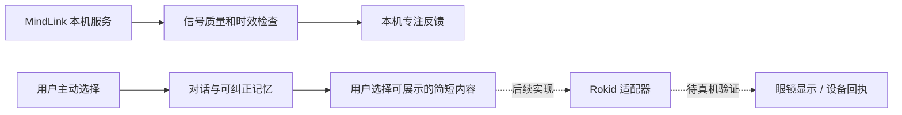

# 念响：产品判断与联调清单

更新时间：2026-10-29。本文区分交接材料、公开资料、已验证行为与待检验假设；本地软件状态以实际验收记录为准。

## 判断：先让一个人愿意回来，把一件心事接住

建议比赛演示主线是：**用户说一件真实经历 → 回响先听并用自然语言接住 → 用户决定是否留下、纠正一条记忆 → 下次回来仍在原对话中接住最新理解 → 用户选择要不要做一件小事**。这是一条产品假设，尚不代表已有用户留存或付费证据。EEG 和眼镜是可选的身体入口，不能代替这条链，也不能把当前设备的专注度包装成情绪。

首批可测试对象建议从团队能触达的真实人群中寻找：忙碌、习惯独自消化人际或工作压力、又不愿每次重复背景的成年人。访谈先问他们最近一次何时有这种需要、用了什么替代方式、愿意留下什么记忆、何时会不想被打扰；不要先把他们定义成心理疾病患者。是否频繁使用与付费仍需验证。

### 为什么这个方向符合现有思路

用户知识库的既有判断是，陪伴的价值在关键时刻唤起合适背景，记忆需要选择、解释和纠错，陪伴应支持现实关系，而不是把人留在对话里。`AI 记忆、陪伴与平行自我` 与 `个性化 Agent 系统` 是用户自己的方向判断，不是市场规模或用户需求证据。知识库还记录了 EchoPin 的 B 端活动实践；它可以作为接触活动客户的线索，不能证明本产品已有订单或订阅收入。

## 竞品：把 Today 的体验拆成可验收能力

| 层 | Today 的公开表达或交接证据 | 念响的取舍 |
|---|---|---|
| 入口 | Today 介绍允许从对话开始，按需连接个人信息；交接包观察到对话、Today、记忆、任务等结构 | 先让人说话；连接应用是邀请，不是入场门槛 |
| 连续性 | Today 官方介绍可使用跨对话记忆，并允许管理记忆 | 先实现用户确认、纠错、删除与在同一对话中持续使用；区分候选与事实 |
| 行动 | Today 官方描述任务与连接应用的能力；具体产品行为和权限取决于连接器 | 用户批准后才执行真实小行动；写入失败不能显示完成 |
| 个性 | 交接逆向材料包含客户端结构和 mock 示例；服务端真实提示词、排序与主动策略未知 | 独立设计回应节奏，不声称复刻了其内部机制 |

资料：[Today 产品能力](https://today.ai/articles/capabilities)、[Today 产品介绍](https://today.ai/articles/blog/what-is-today)。这里的公开资料为厂商自述；交接包锁定的是其记录的特定客户端版本，不等于当前全部行为。

**材料覆盖：**用户补充的本地 PRD 及关联市场决策室可用，包含 33 个产品／运行时、11 类客群和 141 条来源记录，已作为重要调研输入；这些来源记录不等于 141 项独立核验。飞书妙搭原页面已读取并与本地 PRD 比对：主体高度一致，公开分享说明、后续决定与设备资料入口等存在差异；图片及交互未逐项验证。本地 PRD 明确记录了 10 月 28 日已选方向：有上下文的私人陪伴。

### 其他直接替代方案

- [Pi](https://hey.pi.ai/) 强调对话与倾听，其[记忆说明](https://help.pi.ai/en/articles/15425697-pi-s-memory)提供查看、编辑和清除。启发：陪伴的自然节奏和控制权都要测试，不能仅靠情绪化文案。
- [Replika Ultra](https://help.replika.com/hc/en-us/articles/37292892831885-What-is-Replika-Ultra) 把记忆引用和自我反思等能力放进付费权益；[Character.AI](https://character.ai/subscribe) 也围绕记忆、模型和广告形成付费分层。启发：记忆可能构成付费功能，但这只是同类产品的定价设计，不证明本项目的付费意愿。
- 通用 AI 对话工具和现实中的朋友都是替代方案。访谈应比较“是否免于重复背景、是否愿意纠正、是否更敢回到现实关系”，而不只比较聊天时长。

## 商业化：先验证付费者，再谈规模

推荐并行比较两条路径，不把它们当成已验证收入：

1. **个人订阅假设：**为连续的个人上下文、可控记忆和自然陪伴付费。先观察同一用户能否在不同日子主动回来、是否愿意修正记忆、觉得比通用聊天工具节省了什么；再通过真实报价或小额试用验证意愿。不能用模型 token 成本倒推出售价。
2. **活动或组织体验假设：**面向已有可触达的活动主办方，提供明确时长、明确数据归属的可穿戴互动体验；受访者体验的内容不能默认交给主办方。先验证采购对象、付费预算、场地与设备维护负担，以及参与者是否愿意佩戴。此前 EchoPin 的客户线索不等于念响已经成交。

一周内最小验证：找 5 位目标人群各做一次 10–15 分钟体验，至少在 24 小时后邀请其自主回访；记录启动时间、愿意继续说的比例、记忆纠错成功率、第二次是否愿意回来、主动提出付费的金额与理由。小样本只能用于发现问题，不用于估算市场或转化率。

## 硬件边界

### 脑电

队友材料描述的本机 MindLink 桥默认位于 `127.0.0.1:8876`，提供设备的 NeuroSky eSense 专注度估计，非情绪解码。断流、接触不良、伪迹、数据过期时应撤回数值；设备是否可用由真实帧而不是服务在线状态决定。当前软件支持显式开启与停止、有限时间授权、失效后不返回旧分数；**还没有本轮真机验证：设备目前在队友处，后续联调**。体验可使用专注小球或轻量反馈，禁止把分数用于推断心理状态、自动做决定或做医疗承诺。

### Rokid

[Rokid 官方 SDK 文档](https://developerdoc.rokid.com/sdk?lang=en)列出多个产品和开发路径，部分需要商务获取。需确认具体型号、手机系统、配套应用、固件和开发权限，再执行“配对 → 官方示例在镜上显示一句文字 → 断连重连 → 连接回响”的真机验证。用户已决定 Rokid 稍后联调，本轮先预留入口和显示框架。当前没有眼镜连接和显示成功证据；手机或桌面展示不能表述为眼镜已接入。

### 软硬件初步框架（设计提案）

当前脑电分数只显示在本机，不进入模型或记忆。后续如团队要让它影响交互，应单独设计用户同意、失效处理和无脑电对照；眼镜输出应由用户选择内容、支持关闭，并确认真实回执。图中的 Rokid 适配器及实物回执均是规划，不是已实现能力。

## 赛事与现场验收

[ClawHunt 赛事文章](https://mp.weixin.qq.com/s/RAfwuPBH1yFPtNJt0acOMQ)的商业化赛道强调讲清谁付费、跑通最核心一环；评分中的现场 Demo 可用性为 25 分。预选每队 3 分钟，决赛 Demo 5 分钟加问答 3 分钟。第三方库、API 和 AI 工具应按赛事要求说明。[赛事官网公告](https://clawhunt.store/articles/clawhunt-shanghai-hackathon)明确要求参赛代码和素材在活动期间制作，允许赛前准备经验与思考。因此现有原型和本轮代码应作为赛前研究参考；既有代码、开源组件和第三方素材如何复用，需向组委会具体确认。赞助模型 token 默认不含 ZDR，不要提交公司业务信息或敏感个人数据。

现场检查顺序：

1. 同一用户用真实模型完成一轮自然对话；网络失败能明确告知，且不虚构内容。
2. 保存、确认、纠正一条记忆；重新进入并明确选择带入，模型采用最新版本。
3. 连接一个确实可授权的来源，先说明读取和模型处理范围，选择后读取，再核对理解；取消或失败不冒充成功。
4. 若脑电设备就绪，展示真实分数、遮挡或断连时撤回、用户停止后不再读取；没有设备就明确未联调。
5. 用一位非团队成员完成操作，并记录卡点；任何对外写入均要有真实回执与用户确认。

### 现场推进建议（时间估计，不是赛事日程）

- **前 30 分钟：**确认组委会对已有代码、素材及第三方工具的具体边界；锁定一位目标用户和一段对话，准备非敏感测试素材。
- **接下来约 2 小时：**在允许范围内完成对话、模型调用和记忆确认/纠正；现场记录测试对象、输入与实际结果。
- **再用约 2 小时：**打通一项有用户授权的来源，或完成脑电真机接入，选择最有把握的一项；不要把两项都作为主线前置条件。
- **最后约 1–2 小时：**验证错误、断网、停止、旧数据和刷新后的连续性；请一位非团队成员使用，再根据现场状态准备 3 分钟叙事与备用展示。

这些估时以团队成员与设备到位为前提。提前定义可测结果比提前承诺功能数量更重要；现场若硬件不可用，要展示实际软件结果并如实解释限制。

### 当前实现与联调边界（以用户最新要求为准）

正常使用只保留一条持续对话；取消欢迎弹窗、编号、历史切换和重新开始。连接应用留在右侧，聊天持续在场。旧记录保留，不删除、不自动混入当前内容。

本轮已实际走通本机文件→预览→同一对话接入→真实模型问答，真实 Git CLI→指定目录→预览→接入，消息草稿→保存→全文查看，以及待确认动作沿原记录继续确认。Today、任务、记忆、来源的具体修复与证据见同目录《念响-PRD与Today复核-20261029.md》。

Python 388项＋21个子测试、前端308项、桌面18项通过。账号和硬件门槛单独保留：本轮不新增授权、不触发实际系统写入，Rokid／EEG／真手机仍待联调。已安装CLI或页面跳转不能算接通；读取失败不回退演示内容。
