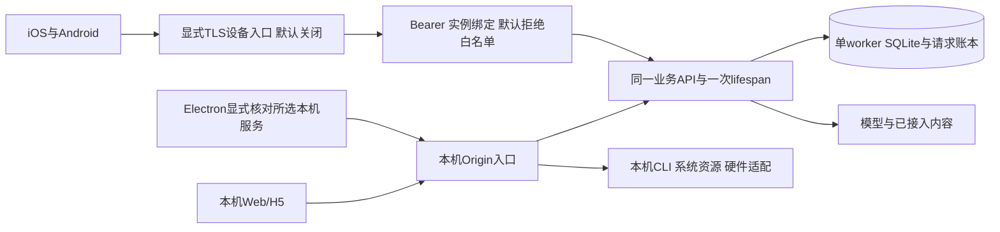

# 多端同步与架构方案 · R15

保留FastAPI + SQLite模块化单体、SwiftUI、Compose、Electron。R13受限设备入口上保留R14变更发现；R15桌面显式选择同一已有本机服务。当前规模继续按业务模块收口，不拆微服务。

## 版本一致与用户数据一致

版本一致由同仓库的shared设计/文案、API快照、实际运行引用检查、同release_id和各包哈希管理。原生布局、读屏、权限和生命周期仍各端验收；资源生成不会自动改所有手写界面。

用户数据当前属于同一成年人的一个后端、一份SQLite持续对话。R13可以通过本人发出的设备码访问受限核心，按实例/设备/凭据代次隔离客户端草稿与unknown。R14在前台通过metadata-only变更游标发现更新，changes-first、快照完整替换、二次稳定复核、原cursor一起采用，编辑/unknown时保留草稿并延后。CAS和请求账本保留；没有云事件推送、自动离线合并或云同步，也不是多账号租户系统。

R15把“使用同一后端”和“复制多份数据库”分开：桌面本人明确选择已有本机地址，内部核对实例及持续对话，按完整身份隔离窗口/本机草稿。该选择不搬移模型凭据，也不自动合并独立空间；共享页面没有owner原生桥和独立通知。手机仍走受限TLS入口，不能把自己的127.0.0.1当电脑。只读草稿归档是文字取回，不恢复旧请求身份/授权，也不是离线写队列。

TLS入口不接受本机owner/凭据/模型配置/系统动作/硬件路由。它不是反向代理随意放行API前缀；认证后使用进程内可信principal进入业务，绑定唯一对话及资源，原始心情操作JSON不重写。撤回期间缓冲敏感响应并在发送前复核。停服时两个listener排空后才释放唯一DB lease。

## 团队改动约定

1. 一套仓库维护server/web/desktop/native/shared；ZIP是快照，不各自长期分叉。
2. 先改shared设计/文案与实际API定义，再生成客户端资源与OpenAPI；以README的生成和检查命令作为合并门槛。
3. 每个业务改动明确Web/H5/macOS/Windows/iOS/Android适用范围。错误码、原请求身份、权限和unknown恢复要一起审查，不能只改文案。
4. 同版本出包并保存源码/runtime/依赖/许可证清单。无SDK时只能交原生源码；安装、启动、声音、权限分别记录证据。
5. 新配对身份不继承旧origin-only草稿；旧unknown不能补ID或自动重发。来源撤回、F5静默、记忆CAS与心情账本回归持续保留。

## 接下来的架构门槛

| 项目 | 仍需完成的验收 |
|---|---|
| 真实手机连接 | 安装App、受信且可达HTTPS、原生证书/安全存储、键盘和前后台实测；本轮不开放LAN/公网 |
| 真正同步 | 已完成同后端前台cursor与完整重读删除/撤回；仍需真实设备事件推送、跨网络部署、断网冲突、离线合并与顺序验收 |
| 桌面发行 | R15连接选择/切回/身份变化完整GUI；Mac签名公证/其他Mac；Windows实际exe启停与中文路径 |
| 本机数据保护 | 逐平台备份/恢复/卸载/密钥丢失/本地内容加密；不能从token保护推断整库加密 |
| 硬件和产品效果 | EEG注意力与Rokid真实ACK/停用、获准联系、6–10名成人使用与付费/成本验证 |

Mac CLI凭据、Apple自动化和MindLink留在电脑适配层；配对手机不能调用这些本机权限。EEG不作情绪解码。暂不新增账号、支付或公开部署。HTTP与令牌合同见设备连接API-R13，变更与游标见跨端更新API-R14，R15选择/草稿范围见第15轮多端交接及各端验收文件。
